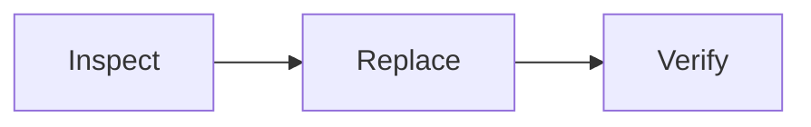

# Weekly line report

A short document artifact, to check how a markdown artifact reads in its card
and at full size.

## Summary

| Day | Picks | Faults |
|-----|------:|-------:|
| Monday | 1,840 | 3 |
| Tuesday | 1,712 | 5 |
| Wednesday | 1,955 | 2 |

- Uptime held above 95 percent every day.
- Two faults were the same gripper pad.

The pick rate is $r = \frac{n}{t}$ picks per hour.
